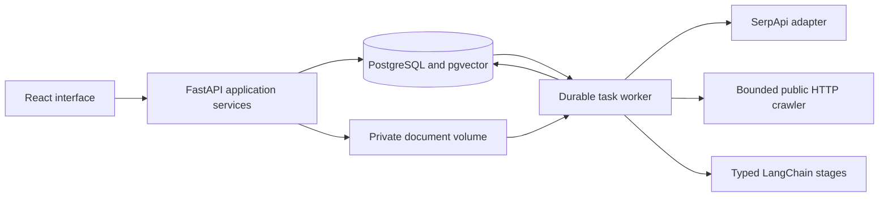

# Architecture and product contracts

Status: intended v1 architecture, established by issue #1 on 5 November 2026.
This documentation does not imply that the application, checks or deployment already exist.
See [the roadmap](../README.md#implementation-roadmap) for delivery dependencies and
[contribution rules](../AGENTS.md) for implementation and review constraints.

## Product boundary

Google Job Hunter helps a user build a reviewed profile and research public job opportunities.
The user controls accepted profile facts, saved searches and manual search execution.
AI proposes facts and explains matches with evidence; it cannot accept facts or apply for jobs.

| Included in v1 | Required outcome or boundary |
| --- | --- |
| Email/password and Google OIDC sign-in | Revocable sessions, verification, recovery and explicit identity linking |
| PDF, DOCX and TXT uploads | Private storage, bounded parsing and source locations |
| Profile extraction and editing | Human-reviewed skills, experience and projects; exact deduplication |
| Grouped keyword search | AND across groups, OR within each group; saved definitions and manual runs |
| Google organic search via SerpApi | Replaceable provider adapter with limits and fixture responses |
| Public HTTP page crawling | Bounded fetches, robots policy, host pacing and source snapshots |
| LangChain processing | Typed cleanup, metadata, requirements and private matching stages |
| Embeddings and pgvector retrieval | Versioned chunks with evidence references |
| Accessible job UI | Owned discovery results, processing states, requirements and match explanations |
| Data controls | Export, document/account deletion and retention with race-safe cleanup |

Scanned PDFs have an explicit unsupported/OCR-required state; v1 does not perform OCR.
JavaScript-only, blocked and unsupported pages have distinct usable states and a safe source link.
Missing fields display as unknown; a failed stage must not appear as an empty successful result.
Exclude Gmail/mailbox access, automatic applications, scraping Google HTML, browser crawling,
recurring/scheduled searches and billing. Maintenance retention jobs do not schedule user searches.

## Runtime and module boundaries

Use one feature-oriented FastAPI modular monolith and a separate Python worker process.
They share domain/application services and infrastructure adapters, with separate composition roots.
PostgreSQL stores application state and durable tasks; pgvector stores embedding vectors.
SQLAlchemy 2 owns persistence mappings and Alembic owns schema evolution, including extensions.
There is no Redis broker, microservice split or generic repository framework.

```text
backend/src/job_hunter/
  api/             HTTP routes, request/response schemas and session context
  application/     Feature use cases, transaction boundaries and narrow ports
  domain/          Feature rules, values and version/ownership invariants
  infrastructure/  SQLAlchemy, task queue, storage and provider adapters
frontend/src/
  app/             Composition, routes and application-wide providers
  features/        Identity, profile, search and job workflows as delivered
  shared/          Small UI primitives, CSS tokens and typed API client
```

These are target locations, not a request to scaffold unused modules.
Group code by feature within each layer; split files when a real use case requires it.
Domain code is independent of HTTP, persistence and providers.
Application code depends on domain values and narrow ports, not FastAPI, ORM models,
LangChain or provider SDKs. Neither domain nor application imports infrastructure.
Adapters translate external representations; composition roots instantiate and inject them.
Ports describe operations actually needed, such as storing a private document or fetching search results.
Use explicit application transaction boundaries instead of a universal repository abstraction.

Use synchronous SQLAlchemy consistently, one session per unit of work, with FastAPI `def` handlers
and synchronous worker jobs. Never share a session between tasks or threads.
Blocking provider work runs in bounded worker execution, not on the API event loop.
If an adapter uses async I/O, isolate it in worker orchestration; never call blocking I/O from an
API async handler. External calls happen outside database transactions and row locks.
The API validates requests and commits intent; long document/search/AI operations return processing state.
Liveness is independent of dependencies; readiness adds a bounded database probe in issue #7.

The frontend uses Vite, React, strict TypeScript, React Router and TanStack Query.
Use a same-origin `/api` boundary in production and an explicit local Vite proxy.
Issue #9 standardizes `/api/v1` errors; the health contract remains `/api/health/live` from issue #2.
Issue #20 exports deterministic OpenAPI and generates ignored TypeScript types before checks/builds.
Fresh generation plus frontend compilation detects drift; do not maintain a second handwritten schema.
Clear private query caches on logout/identity changes; do not automatically retry unsafe mutations.

## Ownership and data conventions

| Data | Ownership and access invariant |
| --- | --- |
| Users, password credentials, identities, sessions | Private account security data; identities uniquely bind issuer and subject |
| Documents, parsed text, extraction proposals | Private to uploader; storage and evidence reads require ownership |
| Accepted profile items and revisions | Private to user; proposals never become facts without review |
| Saved searches and immutable runs | Private definitions, query snapshots, filters and progress |
| Public job sources and content versions | Globally deduplicated public URLs and fetched source snapshots |
| Public job artifacts, chunks and embeddings | Shareable only when derived solely from public content |
| Run-job associations | Private discovery provenance, rank and membership for a user's run |
| Profile matches and explanations | Private to owner; never stored on shared public job artifacts |
| Durable tasks and budget records | Internal; authorization derives from referenced subjects and owners |

All job APIs, including listing, detail, evidence and retry, require a private discovery association
for the authenticated user. A public source's globally unique UUID is not permission to read it.
Apply ownership in application queries/mutations, not only UI route guards; test cross-user access.
Search terms, profile facts, matches and private document hashes must never enter shared public records.
Scope upload deduplication by owner so identical private uploads cannot reveal another user's data.

Use UUID identifiers and timezone-aware UTC storage; serialize timestamps with an explicit offset.
Preserve original-language source text and evidence; English is the language of code, UI and docs.
Use explicit null/unknown values and reason/status where needed; unknown is not false or zero.
Keep salary amount/range, currency, period and quoted evidence separately.
Do not infer a currency, annualize a salary or compare unlike periods using guessed conversions.
Exact normalized keys and database unique constraints govern deduplication under concurrency.
Embeddings may suggest similarity; uncertain semantic merges require a user's decision.

## Profile path and private storage

1. Authenticate the user, enforce upload limits and validate type/content for PDF/DOCX/TXT.
2. Write bytes through a private local-volume storage port using an opaque server-generated key.
3. Commit an owned document record and its parsing task in one database transaction.
4. A worker parses with byte/page/time/memory bounds and preserves page/paragraph/source locations.
5. Typed extraction emits private proposals with evidence, unknowns and duplicate candidates.
6. The user accepts, edits or rejects proposals; decisions and accepted facts commit atomically.
7. Changed accepted facts advance the profile revision; exact duplicates do not add duplicate facts.

The volume is outside the web root, accessible only to API/worker service accounts.
Downloads pass through authorized application access; never expose storage paths as public URLs.
Filesystem writes cannot participate in the database transaction: stage the blob before committing
its reference, and clean abandoned blobs after a grace period. Workers read only committed references.
Storage failure leaves an honest retryable/failed state; it must not produce a readable missing document.
Tombstone documents before cleanup, cancel/fence pending work and recheck deletion before publishing.
Deleting a document removes its bytes, parsed text and unaccepted proposals without reviving them
through late workers. Accepted facts survive with a source-unavailable marker, not retained hidden text.
Account deletion revokes access immediately and fences private work before idempotent cleanup.
Public job facts may survive account deletion; private associations and matches may not.

## Search and public-job path



1. Validate bounded AND-of-OR groups, such as `(Python OR Go) AND (remote OR Paris)`.
2. Persist an owned immutable run snapshot and enqueue execution atomically.
3. Fetch bounded Google organic results through the search port; retain safe result provenance.
4. Canonicalize URLs deterministically and upsert globally unique public sources.
5. Commit private run-job associations and necessary crawl tasks together.
6. Reuse valid completed artifacts; enqueue new sources or authorized missing/stale stages only.
7. Fetch pages, preserve snapshots, sanitize to plain text, then clean and analyze with typed AI.
8. Produce metadata/requirements and deterministic chunks/embeddings with source references.
9. Match explicit job requirements against the user's accepted profile revision.
10. Expose owned results, evidence, unknowns and processing/staleness through the job UI.

Google integration for search uses the replaceable [SerpApi Google Search API](https://serpapi.com/search-api).
The adapter maps organic results into our contract; advertisements are not organic job evidence.
Provider selection and credentials are deployment settings; fixtures are the normal test path.
Google's [Custom Search JSON API notice](https://developers.google.com/custom-search/v1/overview)
states that it is closed to new customers and existing customers must transition by 1 January 2027.
Do not build a new dependency on that service or scrape Google result HTML directly.

The crawler permits bounded public HTTP(S) fetches only. Validate DNS/address destinations and each
redirect against private, loopback, link-local and metadata ranges; protect against DNS rebinding.
Enforce time/size/redirect limits, robots policy, host pacing and allowed content types.
Do not execute page scripts, send account cookies or follow authenticated/private resource links.
Retain canonical/requested/final URLs, fetch time, content hash and relevant fetch outcome.
Deduplicate exact source/content identities without silently merging uncertain jobs.

## Durable tasks and recovery

PostgreSQL is the durable queue; business state and enqueue use the same session/transaction.
A rollback must leave neither an orphan task nor a state change that lost its required task.
Tasks carry kind, subject/version key, payload reference, status, run time, attempts/max attempts,
lease token/expiry and a safe error code. Payloads do not contain raw private content or credentials.
A unique logical task key suppresses duplicate enqueue; database constraints arbitrate races.

Claim registered task kinds with `FOR UPDATE SKIP LOCKED` in short transactions.
Record the lease/fencing token, release locks, then do bounded external work.
Renew leases with heartbeats; reclaim expired leases after a crash.
Completion/failure and artifact publication require the current token and live subject/version.
A stale worker cannot publish artifacts, advance a stage or resurrect deleted private data.
Commit a stage result and the next task atomically, so restart resumes from completed artifacts.

Classify retryable and permanent errors; use capped exponential backoff with jitter and bounded attempts.
An authorized manual retry reopens the same logical task with a new attempt generation/token.
Concurrent retries share one outcome; preserve successful artifacts when retrying another stage.
Unregistered kinds remain pending until a suitable handler is deployed.
Graceful shutdown stops new claims and lets active leases finish or expire safely.

Delivery is at least once. A crash after a provider response but before commit can repeat that call.
Provider idempotency, durable artifact reuse and budgets bound impact; exactly-once billing is not promised.
Reserve per-user and global budgets atomically before paid calls, reconcile known usage, and handle
uncertain outcomes conservatively. Limit attempts, fan-out, input/output tokens, time and concurrent calls.
SDK retries must fit the same budget; nested retries must not multiply the permitted call count.

## Provenance, revisions and AI

Preserved sanitized source remains authoritative even if AI cleanup omits a paragraph.
Cleaning selects/organizes faithful plain text; it must not invent facts or replace source evidence.
Evidence identifies document/content version, location/offset and an exact source passage.
Validate references against that source; invalid or unsupported claims become unknown/rejected outcomes.
Keep original source separate from cleaned text and record mappings through chunking.
Requirements extraction can consult authoritative source when cleaned text loses relevant evidence.

Use [LangChain structured output](https://docs.langchain.com/oss/python/langchain/structured-output)
for schema-constrained results, with application validation of evidence and allowed values.
That reference includes agent examples; this product uses bounded standalone model calls as described
in [model structured output](https://docs.langchain.com/oss/python/langchain/models#structured-output),
not autonomous tool-using agents. No model can browse, execute code or mutate accepted profile facts.
Treat instructions inside uploaded documents, pages or model responses as untrusted data.
Private matching sends only necessary accepted facts/evidence to the configured provider.

| Revision input | Reuse and invalidation rule |
| --- | --- |
| Document bytes/hash and parser version | Parsed text/proposals identify both; deletion prevents republishing |
| Profile revision | Only changed accepted facts advance it; old private matches become stale |
| Public content hash/version | New content invalidates dependent cleanup, facts, requirements and matches |
| Schema, prompt, model and stage version | Artifact identity includes them; incompatible results require a new version |
| Chunker and embedding model/dimensions | Rebuild incompatible chunks/vectors; never mix vector spaces |
| Requirement and matching policy versions | Match identity includes these plus owner, profile and job artifact versions |
| Search definition revision | Each run freezes its inputs; later edits cannot mutate past runs |

Retain immutable artifact identities and explicit current/stale/failed states.
Publish only if expected source/profile versions still apply; a late result cannot become current.
Stale results may remain visible with their age/reason while bounded recomputation is pending.
Never reuse a match across users or score unknown requirements as proven absence.
Explain matched evidence, gaps, unknowns and score limitations; similarity alone is not proof of fit.

## Identity and browser boundary

Email/password supports verification, bounded attempts, single-use recovery and session revocation.
Use revocable secure HttpOnly cookies, CSRF protection, exact origins and trusted hosts.
OAuth uses [Google OpenID Connect](https://developers.google.com/identity/openid-connect/openid-connect)
for sign-in only, with `openid email profile` scopes and validated issuer, audience, expiry and signature.
Bind state/nonce and callback handling to the initiating session; identify accounts by issuer/subject.
Do not automatically merge accounts because emails match. Linking requires explicit intent and recent
reauthentication; unlinking must retain a usable login method. Gmail scopes are excluded.
Use stable safe error codes, English messages, field errors and request IDs without private payloads.
Render external text as text, never executable HTML; expose safe source links and sanitized statuses.

## Interface contract

Use a warm neutral canvas, dark text, one restrained accent and consistent spacing/type/radius tokens.
Use system or locally packaged fonts and small reusable controls; avoid a large bespoke UI framework.
These are acceptance targets for UI issues, using the
[WCAG 2.2 reference](https://www.w3.org/WAI/WCAG22/quickref/), not claims about this documentation-only change:

- Verify 320px, 768px and 1440px viewport widths and 200% text scaling without page-level horizontal overflow.
- Complete authentication, profile review, search, job inspection and account settings with a keyboard.
- Keep focus visible and restore it after dialogs/drawers; all fields have labels and associated errors.
- Target WCAG 2.2 AA: at least 4.5:1 normal-text, 3:1 large-text and 3:1 required UI-indicator contrast.
- Use text/icons alongside status colors, respect reduced motion, and prevent duplicate form submission.
- Show loading, empty, failed, unsupported, unknown and stale states with a useful next action.
- Test long job titles and absent metadata; separate factual job details from uncertain match explanations.
- Require zero serious/critical automated accessibility violations in covered states plus a manual keyboard pass.
- Capture representative desktop/mobile screenshots; automated scans alone do not establish conformance.

## Operator settings and fixture contract

The following settings must be documented and validated as their owning features arrive.
They are configuration categories, not environment variable names already implemented.
No deployment or paid call is part of issue #1; live-provider setup is an operator decision.

| Setting group | Required live configuration | Secret-free local/CI behavior |
| --- | --- | --- |
| Runtime/database | Supported Python/Node, PostgreSQL DSN/pool limits, pgvector and migration version | Pinned local database; isolated disposable data |
| Public URL/browser | Canonical HTTPS URL, callback origins, trusted hosts, cookie/CSRF policy | Explicit localhost origins and same-origin proxy |
| Google OAuth | Client ID/secret, exact redirect URI, consent setup and OIDC issuer | Local signed-token/JWKS fixtures; no Google login needed |
| Transactional mail | Transport credentials, sender, verification/reset URL and token lifetimes | Capturing mail adapter with no outbound delivery |
| Search | SerpApi credential, provider choice, locale and page/result/call bounds | Deterministic organic-result fixtures |
| LLM | Provider credentials, endpoint/model, prompt/schema versions and time/token limits | Typed recorded/fake responses, including malformed and timeout cases |
| Embeddings | Provider credentials, model/version, dimensions and batch bounds | Deterministic vectors with explicit dimensions |
| Storage/retention | Private volume path/permissions, upload limits, document/artifact/task/log retention | Temporary directories and fake clocks; no real personal documents |
| Worker/crawler | Concurrency, leases, heartbeat, retry caps, time/byte/redirect limits and host pacing | Fake clock/HTTP transport plus real queue transactions |
| Budgets | Per-user/global call/token/cost caps, reservation expiry and exhaustion policy | Tiny deterministic budgets and explicit exhausted states |
| Recovery | Backup location/access, restore retention, encryption and restore procedure | Disposable restore exercise when release tooling exists |

Secrets belong in server-side deployment configuration, never the browser bundle or committed fixtures.
Fail startup with redacted validation errors for invalid live configuration; fixtures need no credentials.
Normal CI uses fake providers and denies unexpected external traffic, including provider SDK retries.
Real PostgreSQL and real API/worker/browser journeys remain necessary for integration behavior.
Release work must verify backup/restore of database and private volume together, retention and recovery
without resurrecting deleted data. Operator runbooks and deployment packaging belong to issues #71–#72.
